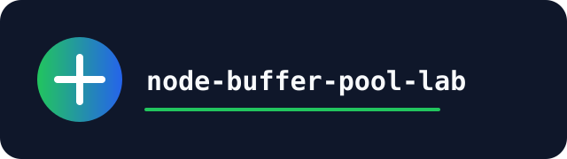

<p align="center"></p>
<p align="center"></p>
<p align="center">   </p>
<p align="center"></p>

## 🧭 Overview

`node-buffer-pool-lab` demonstrates how small Node.js Buffer allocations can share a backing ArrayBuffer. It compares pooled and unpooled allocation paths and reports byte offsets and storage identity. Every unsafe allocation is filled immediately before any bytes are read.

## ✨ Features

- 🧪 Compares `Buffer.alloc`, `Buffer.allocUnsafe`, and `Buffer.allocUnsafeSlow`
- 🧱 Reports backing-store sharing and byte offsets
- 🛡️ Fills unsafe allocations immediately; never displays uninitialized memory
- 📊 Shows the configured `Buffer.poolSize` and allocation metadata
- 📄 Supports text and JSON output

## 🧪 Demo

Run `node src/cli.js`. The report compares three allocation styles and whether small pooled buffers share a backing store. No hosted demo is published.

## 🚀 Quick Start

```bash
node src/cli.js
node src/cli.js --json
npm test
```
Requires Node.js 18 or newer. No package installation is needed.

## 🧰 Tech Stack

- **Stack:** Node.js built-in Buffer API and node:test
- **Approach:** small, local-first tooling with clear output

## 🗂️ Folder Structure

```text
node-buffer-pool-lab/
├── assets/mark.svg
├── src/cli.js
├── tests/buffer.test.js
├── package.json
├── .gitignore
├── LICENSE
└── README.md
```

## 🛣️ Roadmap

- Add configurable allocation sizes and repeated sampling
- Explain pool threshold behavior across Node.js versions

## 🤝 Contributing

Issues and focused pull requests are welcome. Explain the use case, keep changes small, and add tests for behavior changes. Run the project using the Quick Start instructions before submitting.

## 📄 License

Released under the [MIT License](LICENSE).

<p align="center"></p>
